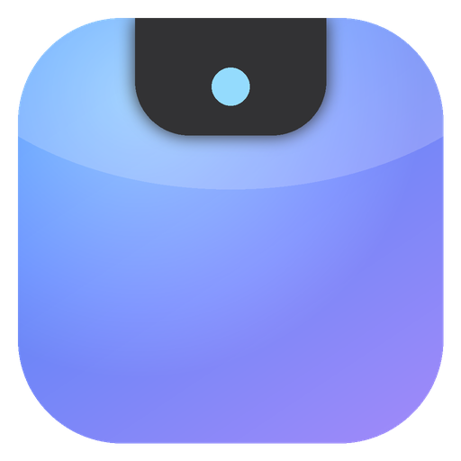

<div align="center">



# IVE

**A living notch for your AI agent — native on Windows and Android.**

Hold a key, drag, and ask. IVE does the work in the background and asks before it touches anything that matters.


</div>

---

## Two native apps. Zero web views.

| | **IVE for Windows** | **IVE for Android** |
|---|---|---|
| Stack | .NET 8 · WPF · Win32 · WinRT | Kotlin · Jetpack Compose · Material 3 |
| Surface | Notch overlay · frosted prompt · control center | Dynamic-Island notch · liquid-glass feed · composer |
| Invoke | Hold **Right Ctrl** + right-click-drag · `Ctrl+Alt+Space` · tray | Composer / notch |
| Glass | DWM acrylic window + real desktop-blur prompt | Layered translucent glass over animated aurora |
| Motion | Per-frame **spring physics**, squash-and-stretch task bubble | Compose spring physics on width / height / radius |
| Auto-fit | PerMonitorV2 DPI, per-display scale, rail ⇄ tab-bar reflow | Edge-to-edge insets, phone ⇄ tablet/foldable two-pane |
| **Voice** | Mic button + `Ctrl+Alt+V`, **Whisper large-v3-turbo (Groq)** | Mic button, **Whisper large-v3-turbo (Groq)** |
| **App control** | Files + shell (approval-gated) | **Operates any app** via Accessibility — asks per app, Stop pill, overlay approvals |
| Music | WinRT now-playing + transport, **you pick the app** | Media-key transport, **you pick the app** |
| Secrets | DPAPI-encrypted API key | Android Keystore (AES-256-GCM) |

## Quick start (Groq — one key does it all)
1. Get a free key at console.groq.com and paste it in **Settings → API key**. Defaults: `llama-3.3-70b-versatile` for the agent, `whisper-large-v3-turbo` for voice. Any OpenAI-compatible endpoint works.
2. **Android:** *Settings → App control* → enable the Accessibility service (and *Display over other apps*). IVE asks before touching each app and you can revoke any time.
3. Pick your **music app** in Settings. Tap the 🎤 and talk.

## What it does
- **Ask in natural language** — the agent plans with an OpenAI-compatible model and uses tools to read, list, write and delete files (and run shell commands on Windows).
- **You stay in control** — anything destructive pops an approval card in the notch (*Approve / Deny*). Cancelling a task denies its pending approvals. System folders are hard-blocked.
- **Always visible, never in the way** — the Windows notch is click-through except over the glass; it expands on hover (music), while working (live status) and when it needs you (approval).

## Get it
Download the latest `IVE-…-windows-x64.exe` and `IVE-…-android.apk` from **[Releases](../../releases)** (see [docs/ENABLE_CI.md](docs/ENABLE_CI.md) to turn on the build pipeline).
First launch opens **Settings** — paste your API key (and optionally change base URL / model), hit **Test connection**.

## Build from source
```bash
# Windows app (Windows 10 1903+ / 11, .NET 8 SDK)
dotnet publish apps/windows/src/Ive.App/Ive.App.csproj -c Release -r win-x64 \
  --self-contained true -p:PublishSingleFile=true -o out/windows
dotnet test apps/windows/tests/Ive.Core.Tests/Ive.Core.Tests.csproj     # works on Linux/macOS too

# Android app (JDK 17, Android SDK 34)
cd apps/android && ./gradlew :app:testDebugUnitTest :app:assembleDebug
# → app/build/outputs/apk/debug/app-debug.apk
```

## Repository layout
```
apps/
  windows/   Ive.Core (agent, tools, tasks, settings — platform-neutral, tested)
             Ive.App  (WPF UI, hooks, WinRT media, DWM)  ·  tests/
  android/   Kotlin + Compose app, Gradle wrapper
docs/        ARCHITECTURE · RELEASING · ENABLE_CI
ci/          GitHub Actions workflows (activate per docs/ENABLE_CI.md)
assets/      brand icons
```

## Security
HTTPS-only endpoints, encrypted key storage, approval-gated actions, protected system paths, Android file sandbox.
Read the honest threat model in [SECURITY.md](SECURITY.md).

## Contributing
See [CONTRIBUTING.md](CONTRIBUTING.md). Architecture overview: [docs/ARCHITECTURE.md](docs/ARCHITECTURE.md).

## License
[MIT](LICENSE) © 2026 Srijan Singh
