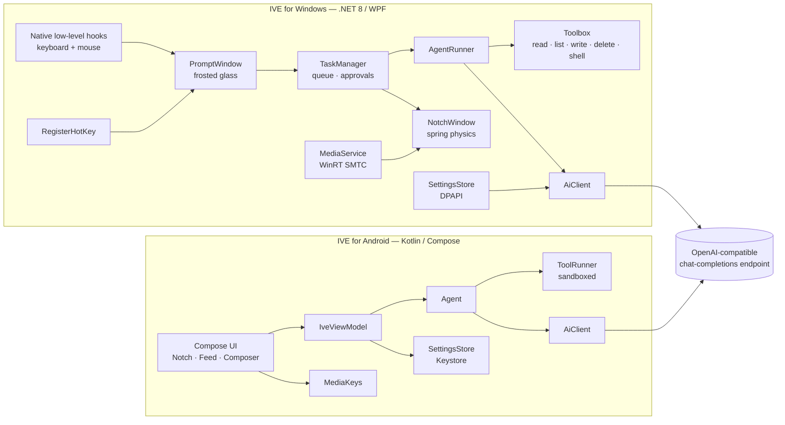

# Architecture

IVE is two **fully native** apps that share a design language and a behavioral contract, not a runtime.
There is no web view, no Electron, no cross-platform UI toolkit.

## Principles
1. **Logic below the UI.** On Windows, everything testable lives in `Ive.Core` (no WPF reference). Windows are thin views.
2. **Approvals are first-class.** The agent can only reach destructive tools through an approval broker; cancelling a task denies its pending approvals.
3. **Interruptible motion.** The notch is driven by real spring physics stepped per frame (velocity survives retargeting), with velocity-based squash-and-stretch on the detached "task bubble". Storyboard animations use a damped-spring easing.
4. **Auto-fit, not device sniffing.**
   - *Windows*: PerMonitorV2 DPI; UI scale derived from the target display's logical width (`√(w/1920)`, clamped); window reflows from side rail to bottom tab bar under 700 DIP; windows are placed per-monitor in physical pixels.
   - *Android*: edge-to-edge with `safeDrawing` insets (cutouts, gesture bars, IME); single column on phones, two panes ≥ 720 dp (tablets, foldables, landscape); notch width = `min(420 dp, screen − 24 dp)`.
5. **Real glass where the OS allows it.** Control center uses DWM acrylic. The prompt box blurs an actual snapshot of the desktop behind it.

## App control on Android (how "ask first" works)
1. `open_app` / any UI tool → `ToolRunner.ensureGranted(pkg)`: if the app has no grant, the user gets an **Allow / Deny** card (in-app notch, or the accessibility **overlay** when IVE isn't on screen). *Allow* is stored in `AppGrants`; revoke in Settings.
2. Every UI action re-checks the **current foreground package** — switching apps mid-task cannot bypass a grant.
3. `IveAccessibilityService` reads a compact numbered tree (passwords masked) and performs `ACTION_CLICK` / `SET_TEXT` / scroll or falls back to gestures. A floating pill shows what IVE is doing with a **Stop** button.

## Voice
`VoiceRecorder` (WinMM / MediaRecorder) → `SpeechClient` → `POST {base}/audio/transcriptions` with `whisper-large-v3-turbo`. The voice key/base URL are optional and default to the main ones.

## Behavioral parity
| Capability | Windows | Android |
|---|---|---|
| Invoke | Hold trigger + right-drag (swallows the right-click), `Ctrl+Alt+Space`, tray | Open app / composer |
| Notch | Top-center overlay, click-through | In-app Dynamic-Island surface |
| Tools | files + shell (approval-gated) | sandboxed files, device info, open link |
| Voice | NAudio → Groq Whisper | MediaRecorder → Groq Whisper |
| App control | Files + shell | Accessibility (any app, per-app grant) |
| Music | WinRT now-playing, user-chosen app | Targeted media buttons, user-chosen app |
| Secrets | DPAPI | Keystore |
